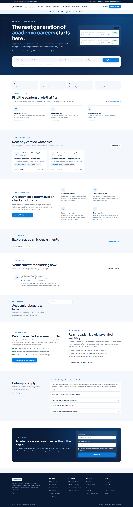
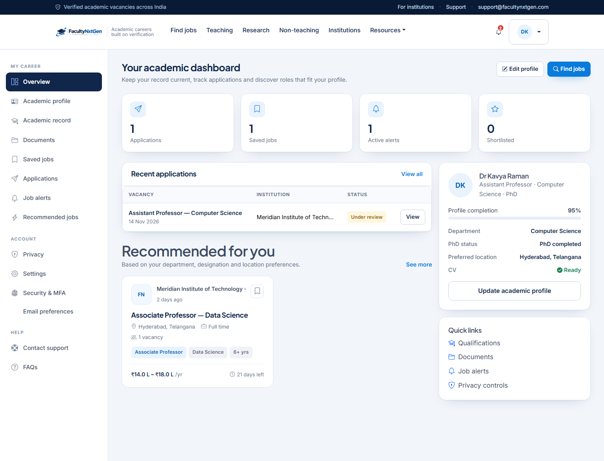
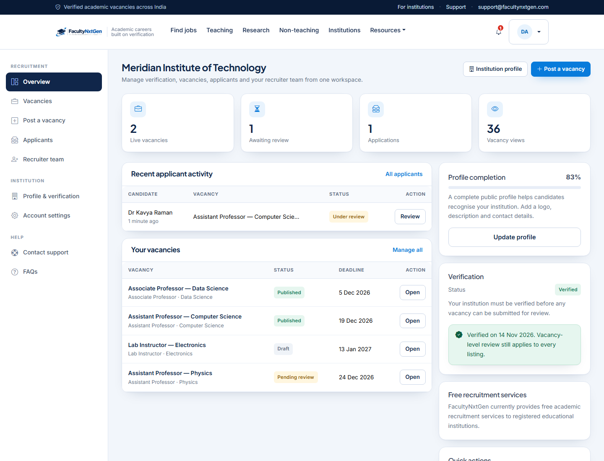
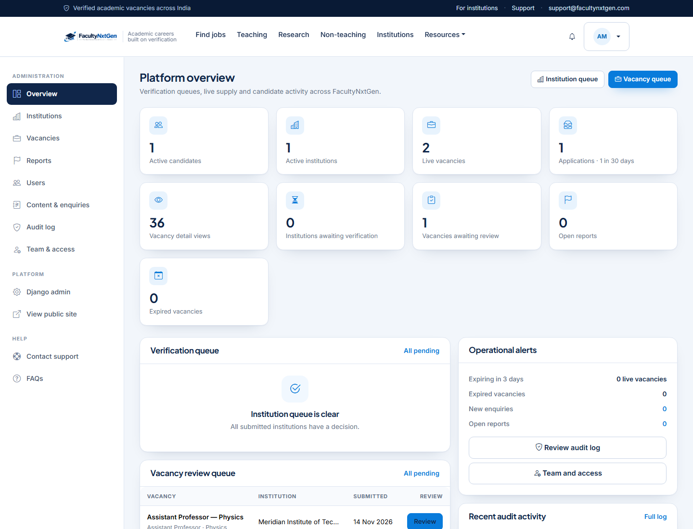

# Free-Launch Conversion Report

**Status:** Complete
**Date:** 14 November 2026
**Platform:** FacultyNxtGen
**Change:** Converted the platform to a completely free academic recruitment service and removed the payment runtime.

---

## 1. Outcome

FacultyNxtGen now provides free academic recruitment services to candidates and registered educational institutions. The public site, candidate portal, institution portal, job workflow, application workflow, document handling, notifications and staff console remain available. No payment, subscription, invoice, refund, checkout, webhook or paid-placement workflow can be initiated from the frontend or backend.

The retired `apps.payments` package is retained only as a migration holder so existing databases can drop the legacy payment tables. It exposes no models, views, URLs, admin, forms, tasks or services.

---

## 2. Required free-launch messaging

| Location | Exact copy |
| --- | --- |
| Homepage announcement | **Free Academic Job Posting for Educational Institutions.** |
| Candidate CTA | **Explore Academic Opportunities.** |
| Institution CTA | **Register Your Institution — Free.** |
| Institution dashboard | **FacultyNxtGen currently provides free academic recruitment services to registered educational institutions.** |

These strings are implemented in `templates/public/home.html` and `templates/institutions/dashboard.html`, and are asserted by `apps/core/tests_free_launch.py`.

---

## 3. Removed functionality

### Payment and billing runtime

- Razorpay order creation, checkout callback verification, webhook verification and replay handling.
- Plan catalogue, pricing, plan quotas, job limits and recruiter-seat limits.
- Monthly/annual subscriptions and institution subscription windows.
- Orders, payments, invoices, PDF invoice generation, billing history, GSTIN and tax settings.
- Refund requests, refund decisions, provider refund references and refund emails.
- Payment receipts and refund-update email templates.
- Payment dashboard statistics, payment queues, order inspection and refund administration.
- Payment notification category and payment-related in-app notifications.
- Payment navigation links, buttons, forms, pages, URLs and endpoints.
- Featured/premium paid advertisements, paid placement windows, featured badges and featured-first ordering.
- Razorpay CSP origins, payment environment variables, gateway secrets and billing settings.
- Celery advertisement-expiry schedule.
- `razorpay` and `reportlab` dependencies (no remaining active module imports them).

### Removed files

- `apps/payments/` runtime modules (models, views, URLs, admin, forms, services, invoice, Razorpay client, tasks, tests).
- `templates/payments/`.
- `templates/dashboard/admin/payments.html`.
- `templates/dashboard/admin/payment_detail.html`.
- `templates/emails/payment_receipt.html` and `.txt`.
- `templates/emails/refund_update.html` and `.txt`.
- `static/js/payments.js`.

### Retained only for migration history

- `apps/payments/__init__.py`, `apps/payments/apps.py`.
- `apps/payments/migrations/0001_initial.py`.
- `apps/payments/migrations/0002_remove_payment_models.py`.

---

## 4. Retained free features

### Candidates

- Registration, email verification, login, password reset and account security.
- Academic profile, qualifications, teaching/research experience, publications and certifications.
- CV and supporting document uploads through private storage with signed downloads.
- Saved jobs, job alerts, recommendations, applications and withdrawal.
- In-app notifications and email preferences.
- Data export and account-deletion request.

### Institutions

- Institution registration with verification documents and primary recruiter creation.
- Institution verification workflow and profile management.
- Recruiter invitations and team management without seat limits.
- Free vacancy drafting, editing, cloning, submission, pausing and deletion.
- Staff review, approval, publication, rejection and suspension.
- Applicant review, internal notes, controlled status transitions and candidate communication.
- Analytics for vacancy views, applications and candidate engagement.

### Administration and platform

- Institution verification, job publication and moderation queues.
- User moderation, reports, content/enquiries and team access.
- Audit log viewer.
- Public job search, landing pages, institution directory and job detail pages.
- Blog, FAQ, contact, newsletter double opt-in, legal pages and cookie preferences.
- Private document access control, rate limiting, CSP, MFA for staff and audit logging.

---

## 5. Database migrations

Applied successfully with `python manage.py migrate`.

| Migration | Purpose |
| --- | --- |
| `apps/institutions/migrations/0002_alter_institution_options_and_more.py` | Changes institution ordering to `name` and removes `Institution.is_featured`. |
| `apps/jobs/migrations/0002_alter_job_options_and_more.py` | Changes job ordering to `-published_at, -created_at`; removes the featured index, `featured_until` and `is_featured`. |
| `apps/notifications/migrations/0002_alter_notification_category.py` | Removes `payment` from notification category choices. |
| `apps/notifications/migrations/0003_reclassify_payment_notifications.py` | Moves any existing `payment` notifications to `account`. Data-only; no candidate/institution/job/application records are removed. |
| `apps/payments/migrations/0002_remove_payment_models.py` | Drops `Advertisement`, `InstitutionSubscription`, `Refund`, `Payment`, `Invoice`, `Order`, `WebhookEvent` and `Plan` in dependency order. |

Verification:

- `python manage.py makemigrations --check --dry-run` → **No changes detected**.
- Schema introspection → **no legacy payment/order/invoice/refund/subscription/advertisement/plan tables remain**.
- `apps.payments` app config → **0 models**.

No candidate, institution, job, application, document, notification or audit records were deleted by these migrations.

---

## 6. Updated files (grouped)

### Configuration and dependencies

- `.env.example` — removed Razorpay, GST and billing variables.
- `requirements/base.txt` — removed `razorpay` and `reportlab`; retained `requests` (Resend) and `qrcode` (MFA).
- `config/settings/base.py` — removed payment settings, CSP origins, currency and advertisement-expiry schedule; `apps.payments` remains installed as migration-only.
- `config/urls.py` — removed the `/payments/` URL include.
- `README.md` — free-launch overview, routes, dependencies, tests and limitations.

### Applications and migrations

- `apps/payments/apps.py`, `apps/payments/migrations/0001_initial.py`, `apps/payments/migrations/0002_remove_payment_models.py`.
- `apps/dashboard/views.py`, `apps/dashboard/urls.py` — removed payment statistics, payment views and payment routes; added job-view and expired-job statistics.
- `apps/jobs/models.py`, `apps/jobs/services.py`, `apps/jobs/recruiter_views.py` — removed featured fields/ordering and plan quota gates; fixed job-alert delivery exclusion.
- `apps/institutions/models.py` — removed featured and subscription fields.
- `apps/notifications/models.py` — removed the payment category.
- `apps/core/templatetags/fng.py` — added `salary_short`; removed `inr`/`inr_short`.
- `apps/core/management/commands/seed_reference.py` — removed plans and pricing data.
- `apps/core/tests_free_launch.py` — 15 free-launch regression tests.

### Templates and static assets

- Public: `home.html`, `advertise.html`, `about.html`, `terms.html`, `privacy.html`, `contact.html`, `disclaimer.html`, `faq.html`.
- Candidate/institution: candidate application templates, `institutions/dashboard.html`, `institutions/directory.html`, `institutions/recruiters.html`, `institutions/recruiter_invite.html`.
- Jobs: `jobs/detail.html`, `jobs/recruiter_detail.html`, `jobs/recruiter_analytics.html`, `jobs/report.html`, `partials/job_card.html`.
- Admin/dashboard: `base.html`, `partials/dashboard_nav.html`, admin home, institution/user/team/audit/job-detail pages, notifications list.
- Accounts/email/errors: `accounts/delete_account.html`, `emails/base.html`, `emails/account_deletion.html`, `emails/account_deletion.txt`, `errors/500.html`.
- `static/css/app.css` — removed plan-card, order-summary, payment-status, featured-card and ribbon styles.
- Deleted `static/js/payments.js` and all payment templates.

### Documentation

- `documentation/architecture.md` — free recruitment model and retired payment schema.
- `documentation/deployment.md` — no payment credentials or webhooks; free-flow smoke test.
- `documentation/security.md` — retired payment surface; free-launch security checklist.
- `documentation/phase-1-report.md` — annotated as historical; retired payment sections marked.
- `documentation/free-launch-report.md` — this report.

### Screenshots

- `documentation/screenshots/homepage-free-launch.png`
- `documentation/screenshots/candidate-dashboard-free-launch.png`
- `documentation/screenshots/institution-dashboard-free-launch.png`
- `documentation/screenshots/admin-dashboard-free-launch.png`

---

## 7. Test and verification results

| Command | Result |
| --- | --- |
| `python manage.py test` | **101 tests passed**, `OK`, 10.490s |
| `python manage.py check` | **No issues** (2 development-only rate-limit checks silenced) |
| `python manage.py makemigrations --check --dry-run` | **No changes detected** |
| `python manage.py check --deploy` | **No issues** (0 silenced) with temporary production environment values |
| `python manage.py migrate` | All migrations applied successfully |
| `python manage.py seed_reference` | 36 states/UTs, 183 cities, 29 departments, 20 designations, 10 FAQs |

### New free-launch tests

`apps/core/tests_free_launch.py` contains 15 tests covering:

1. Homepage exact free-posting announcement and both CTAs.
2. Institution dashboard exact free-services message.
3. Public pages do not advertise paid plans or payment phrases.
4. Retired payment routes are not reversible.
5. `/payments/` is not served and does not resolve.
6. The payment app exposes no models, views or URLs.
7. No payment credentials or billing settings are required.
8. `payment` is not a notification category.
9. Paid-placement fields and helpers are gone.
10. Payment templates and scripts are gone.
11. Candidate registration works without payment.
12. Institution registration works without payment.
13. Institution verification and job publication work without payment.
14. Candidate application and recruiter review work without payment.
15. Job alerts work without payment.

### Additional runtime checks

- URL resolver scan: **0** payment/checkout/webhook/invoice/refund/subscription routes across **400** resolved routes.
- Database introspection: **0** legacy payment-related tables.
- Payment app model registry: **0** models.
- Browser capture: homepage, candidate dashboard, institution dashboard and admin dashboard loaded with **0 console errors and 0 failed asset requests**.

---

## 8. Payment reference audit

Remaining references were reviewed and classified. There is **no executable payment functionality**.

| Location | Reference | Classification |
| --- | --- | --- |
| `apps/payments/migrations/0001_initial.py` | Legacy plan/order/payment/invoice/refund/advertisement schema | **Historical** — migration history only; tables dropped by `0002`. |
| `apps/payments/migrations/0002_remove_payment_models.py` | `DeleteModel` operations | **Inactive cleanup** — runs only during `migrate` to drop legacy tables. |
| `apps/payments/apps.py`, `config/settings/base.py` | Migration-only app registration | **Inactive runtime** — no models, views, URLs, tasks or services. |
| `apps/jobs/migrations/0001_initial.py`, `apps/institutions/migrations/0001_initial.py` | Old `is_featured`/`featured_until` fields and ordering | **Historical** — fields removed by the `0002` migrations. |
| `apps/jobs/migrations/0002_*`, `apps/institutions/migrations/0002_*` | RemoveField/RemoveIndex operations | **Active migration cleanup** — no payment workflow. |
| `apps/notifications/migrations/0001_initial.py` | `payment` notification category | **Historical** — category removed in `0002`. |
| `apps/notifications/migrations/0003_*` | Reclassify legacy payment notifications | **Active data migration** — preserves rendering; no payment workflow. |
| `apps/core/models.py`, `apps/core/admin.py` | `BlogPost.is_featured` | **Active editorial flag** — blog curation, not paid placement. |
| `apps/core/views.py`, newsletter templates/tests | Newsletter “subscription” wording | **Active newsletter terminology** — not a paid subscription. |
| `apps/core/middleware.py` | `payment=()` Permissions-Policy; `upgrade-insecure-requests` CSP directive | **Active security headers** — browser feature policy, not a payment or plan feature. |
| `templates/public/advertise.html`, `templates/public/terms.html`, `README.md`, `documentation/architecture.md`, `documentation/security.md`, `documentation/deployment.md` | Free-launch copy and negative references | **Active documentation/copy** — no executable payment. |
| `documentation/phase-1-report.md` | Historical payment sections | **Historical** — annotated as superseded. |
| `apps/core/tests_free_launch.py` | Forbidden phrases, retired route names, removed settings | **Active regression tests** — negative assertions only. |
| `logs/facultynxtgen.log` | 5 old “Rejected Razorpay webhook” warnings | **Historical logs** — generated by removed tests before the conversion; no runtime effect. |
| `templates/accounts/register.html` | “career plan” | **Non-payment English usage**. |

---

## 9. Security verification

- **No payment credentials required:** production `check --deploy` passed with only `DJANGO_SECRET_KEY`, `DJANGO_ALLOWED_HOSTS`, `CSRF_TRUSTED_ORIGINS`, `DATABASE_URL` and `REDIS_URL`.
- **No active payment endpoints:** `/payments/` returns 404; no payment namespace, checkout, webhook, invoice or refund route exists.
- **No active payment webhooks:** the payment app has no views or URL configuration.
- **No payment secrets in startup:** no Razorpay/GST/billing settings exist in `config/settings`.
- **No payment data model:** legacy tables are dropped; the app registry has no payment models.
- **No paid placement required for publication:** job publication is gated only by institution verification and the staff review checklist.
- **Preserved controls:** authentication, role decorators, institution isolation, private document access, signed downloads, CSRF, CSP, rate limiting, staff MFA and audit logging remain in place.
- **Legacy notifications:** any old `payment` category rows are reclassified to `account`; no payment notification can be created.

---

## 10. Screenshots

### Homepage — free academic job posting

### Candidate dashboard

### Institution dashboard — free recruitment services

### Admin dashboard — non-payment analytics

Temporary demo data was used only for these screenshots and was removed afterwards. The development database is back to baseline: 1 user, 0 institutions, 0 jobs, 0 applications and 0 documents.

---

## 11. Notes and limitations

- The workspace has no git repository; all changes are present in the working tree.
- Development uses SQLite. Production still requires PostgreSQL and Redis.
- The retired `apps/payments` app must remain installed until every deployed database has applied `payments.0002_remove_payment_models`; removing it earlier would leave legacy tables behind.
- Historical payment references remain only in migration history, the annotated Phase 1 report, negative regression tests, non-payment terminology (newsletter/editorial blog flag/security headers) and old log lines.
- Live Resend and ClamAV provider flows were not exercised; they are unrelated to the payment removal.
